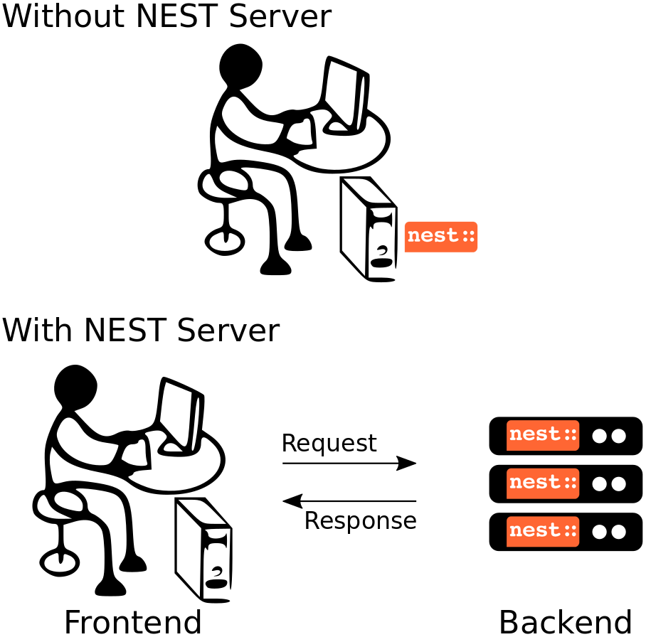

# NEST Server

## What is NEST Server?

NEST Server enables users to interact with the NEST simulation engine via a RESTful API. Using this approach, you can
perform the same basic operations as with [PyNEST](https://nest-simulator.readthedocs.io), but instead of doing so by
directly importing the ```nest``` module, all commands, including their arguments and result data, are channeled through
HTTP requests and responses over a TCP/IP connection.

The main advantage of using NEST in this way is that it decouples the *simulation backend* in the form of the NEST
simulation kernel from the *frontend*, i.e., the code that controls the simulation. In such a scenario, only the backend
(the *server*) depends on NEST, while the frontend could really be anything that can talk HTTP. Under the hood, NEST
Server forwards the commands it receives to PyNEST, and sends back the result data in response packets.

NEST Server was initially developed as a backend for [NEST Desktop](https://nest-desktop.readthedocs.io), a web-based
graphical frontend for NEST. With growing interest in a more general server backend for NEST, the functionality of the
original NEST Server was extended to accommodate for this broader range of application. Starting with NEST 3.0, the NEST
Server was integrated into the main source code repository of NEST to make it available to everyone in a convenient way.

## Use cases for NEST Server



NEST Server can be considered a language independent interface to NEST that can be deployed either locally or on a
remote machine. To give you a better idea of what NEST Server is good for, here are some of its main use cases.

One scenario in which NEST Server comes in handy, is if you want to work on your laptop, but run your NEST simulations
on a machine with higher performance or more memory, for instance, a big workstation or computer cluster at your lab.
For this, you would deploy NEST Server on the remote machine, and use the
[NEST Client](https://github.org/nest/nest-client) locally or write your own client using one of the recipes provided in
the [section on advanced applications](#advanced-topics).

[NEST Desktop](https://nest-desktop.readthedocs.io), the web-based graphical user interface for NEST, uses NEST Server
as its simulation backend. It supports server instances running either locally or remotely. More details about how to
configure and run this setup can be found in the documentation of NEST Desktop.

Last but not least, a version of the [HBP Neurorobotic Platform](https://neurorobotics.net/) use the NEST Server to
run the neuronal simulation as part of closed-loop robotic experiments. As it has rather specific requirements on the
client side, it uses a custom client for the NEST Server instead of the generic one shipped with NEST.

If you yourself have an interesting situation in which you use NEST Server and would like to have it listed here, feel
free to [drop us a line](https://github.com/nest/nest-server/issues).

## Install NEST Server

NEST Server is included in all source code distributions of NEST and consequently, also available in derived packages,
our virtual machine, and Docker images.

For native installations, the package can be simply installed via ```pip```:

```bash
pip install nest-server
```

or in a virtual environment in case you prefer using ```uv```:

```bash
uv pip install nest-server
```

or by installing the full NEST development environment in case you prefer using ```mamba```:

```bash
cd <nest-source-dir>
mamba env create -p mamba/
mamba activate mamba/
```

As an alternative to a native installation, NEST Server is available from the NEST Docker image.

## Run NEST Server

All NEST Server operations are managed using the ```nest-server``` command that can either be run directly:

```bash
nest-server start
```

or supplied to the execution command line for running the Docker container:

```bash
docker run -it --rm -e NEST_CONTAINER_MODE="nest-server" -p 52425:52425 nest/nest-simulator:dev
```

The generic invocation command line for the ```nest-server start --help``` command looks as follows:

```bash
Usage: nest-server start [OPTIONS]

Options:
-d, --daemon           Run NEST Server in the background, i.e. daemonize the
                        server process
-h, --host TEXT        Use hostname/IP address for the server [default:
                        127.0.0.1]
-p, --port INTEGER     Use port for opening the socket [default: 52425]
-o, --outputs          Print NEST outputs to the console
-t, --timeout INTEGER  Workers silent for more than this many seconds are
                        killed and restarted [default: 30]
-w, --workers INTEGER  The number of worker processes for handling requests
                        [default: 1]
--help                 Show this message and exit.
```

### Set environment variables for security options

NEST Server comes with a number of access restrictions that are meant to protect your computer. After careful
consideration, each of the restrictions can be disabled by setting a corresponding environment variable.

* ```NEST_SERVER_DISABLE_AUTH```: By default, the NEST Server requires a NESTServerAuth tokens. Setting this variable to
  ```true``` disables this restriction. A token is automatically created and printed to the console by NEST Server upon
  start-up. If needed, a custom token can be set using the environment variable  ```NEST_SERVER_ACCESS_TOKEN```
* ```NEST_SERVER_CORS_ORIGINS```: By default, the NEST Server only allows requests from localhost (see
  [CORS](https://developer.mozilla.org/en-US/docs/Web/HTTP/CORS)). Other hosts can be explicitly allowed by supplying
  them in the form http://host_or_ip:\* to this variable (By default: http://localhost:\*).
* ```NEST_SERVER_ENABLE_EXEC_CALL```: By default, NEST Server only allows calls to its PyNEST-like API. If the use-case
  requires the execution of scripts via the ```/exec``` route, this variable can be set to ```true```.
  NOTE: PLEASE BE AWARE THAT THIS OPENS YOUR COMPUTER TO REMOTE CODE EXECUTION.
* ```NEST_SERVER_DISABLE_RESTRICTION```: By default, NEST Server runs all code passed to the ```/exec``` route through
  RestrictedPython to sanitize it. To disable this mechanism, this variable can be set to ```true```.
* ```NEST_SERVER_MODULES```: For increased security, code passed in this way only allows explictly whitelisted modules
  to be imported. To import modules, the variable can be set to a standard Python import line like this:
  ```NEST_SERVER_MODULES='import nest; import scipy as sp; from numpy import random'```

### Run with MPI

If NEST was compiled with support for distributed computing via MPI, it will usually execute the exact same simulation
script on each of the `MPI` processes. With NEST Server, this would normally mean that one NEST Server instance would be
spawned for each rank in a multi-process NEST simulation. To prevent this from happening, we provide a special version
of the NEST Server command for use with MPI. It can be run as follows:

```bash
nest-server-mpi start -n N [--host HOST] [--port PORT]
```

If run like this, the RESTful API of the NEST Server will only be served by the `MPI` process with rank 0 (called the
```master```), while all other N-1 ranks will start the NEST Server in ```worker``` mode. Upon receiving a request, the
master relays all commands to the workers, which execute them, collect all result data, and send it back to the master.
The master then receives and combines all worker responses, and replies to the caller of the NEST Server API.

The response data in such a distributed scenario looks almost completely the same as one coming from the serial version
of the NEST Server. The only difference may be that information pertaining to process-local data structures is being
replaced by generic values.


## REST API overview

| URL | Description |
| --- | ----------- |
| ```localhost:52425``` | Get the version of NEST used by NEST Server, e.g. ```{"mpi":false,"nest":"3.10.0"}``` |
| ```localhost:52425/api``` | List all available functions |
| ```localhost:52425/api/<call>``` | Execute the function ```<call>``` |
| ```localhost:52425/api/<call>?inspect=getdoc```| Get the documentation for the function ```<call>``` |
| ```localhost:52425/api/<call>?inspect=getsource``` | Get the source code of the function ```<call>``` |
| ```localhost:52425/exec``` | Execute a Python script. This requires JSON data in the JSON form ```{"source": "<script>", "return": ""}``` |

## Low-level API usage

The preferred command line tool for interacting with NEST Server using a terminal is ``curl``. For more information,
please visit the [curl website](https://curl.se/).

To obtain basic information about the running server, run:

```bash
curl localhost:52425
```

NEST Server responds to this by sending data in JSON format:

```json
{"mpi":false,"nest":"3.11"}
```

You can retrieve data about the callable functions of NEST by running:

```bash
curl localhost:52425/api
```

Retrieve the current kernel status dict from NEST:

```bash
curl localhost:52425/api/GetKernelStatus
```

Send API request with function arguments in JSON format:

```bash
curl -H "Content-Type: application/json" -d '{"model": "iaf_psc_alpha"}' localhost:5000/api/GetDefaults
```

> [!NOTE]
>
> You can beautify the output of NEST Server by piping the output of ```curl``` through the JSON processor ```jq```.
> A sample command line to display the available functions in this way looks like this::
>
> ```bash
> curl -s localhost:52425/api | jq -r .
> ```
>
> For more information, check the [documentation on jq](https://stedolan.github.io/jq/).


## API access from Python

If you prefer Python over ```curl```, you can use the ```requests``` module, which provides a convenient API for
communicating with RESTful APIs. On most systems this is already installed or can be easily installed using ``pip``.
Extensive documentation is available on the pages about [HTTP for Humans](https://requests.readthedocs.io/en/master/).

Sending a simple request to the NEST Server using Python works as follows:

```python
import requests

requests.get("http://localhost:52425").json()
```

To display a list of callable functions, use::

```python
requests.get("http://localhost:52425/api").json()
```

Reset the NEST simulation kernel (no response)::

```python
requests.get("http://localhost:52425/api/ResetKernel").json()
```

Sending an API request in JSON format::

```python
requests.post("http://localhost:52425/api/GetDefaults", json={"model": "iaf_psc_alpha"}).json()
```

Create neurons in NEST and return a list of IDs for the new nodes::

```python
neurons = requests.post("http://localhost:52425/api/Create", json={"model": "iaf_psc_alpha", "n": 100}).json()
print(neurons)
```

## Security considerations

As explained above, the ```/exec``` route of the NEST Server API allows you to run custom Python scripts within the NEST
Server context. This can greatly simplify your workflow in situations where you already have the simulation description
in the form of a Python script. On the technical side, however, this route exposes a potential risk for the remote
execution of malicious code.

In order to protect the execution environment from such security breaches, we execute all user supplied code in a
[RestrictedPython](https://restrictedpython.readthedocs.io/en/latest/) trusted environment. Consequently, this
environment blocks your scripts from importing additional Python modules, unless they are explicitly safelisted during
the start-up of NEST Server.

To mark modules as safe for execution within NEST Server and make them available to code from user supplied scripts that
run through the ```/exec``` route, a comma separated list of Python module names can be assigned to the environment
variable ```NEST_SERVER_MODULES``` prior to starting the NEST Server.

For instance, if your script requires NumPy in addition to PyNEST, the command line for starting up the server would
look like this:

```bash
export NEST_SERVER_ENABLE_EXEC_CALL=true
export NEST_SERVER_MODULES="import nest; import numpy; import numpy as np"
nest-server start
```

After this, NumPy can be used from within scripts in the regular way:

```python
from nest_client import NESTClient

nest = NESTClient()
response = nest.exec_script("a = np.arange(0, 10, 2)", "a")
print(response["data"])  # [0, 2, 4, 6, 8]
```

> [!CAUTION]
>
> Each modification to the default security settings of NEST Server should be carefully evaluated on a case-by-case
> basis.
>
> We are aware that some simulation code might not work (well) in a ```RestrictedPython``` environment. To support such
> codes, the security features of NEST Server can be completely disabled by starting it in the following way:
>
> ```
> export NEST_SERVER_DISABLE_RESTRICTION=true
> nest-server start
> ```
>
> Please be aware that running NEST Server like this bears a high risk of arbitrary remote code execution, and this
> mode of operation should only be used in exceptional cases. We cannot provide any support for problems arising from
> such a use of NEST Server.

## Advanced topics

### Run scripts in NEST Server using `curl`

As shown above, you can send custom simulation code to ```localhost:52425/exec```. On the command line, this approach
might be a bit more challenging in the case your script does not fit on a single line. For such situations, we recommend
using a JSON file as input for ```curl```:

```json
{
    "source": "
    import nest\n
    # Reset kernel\n
    nest.ResetKernel()\n
    # Create nodes\nparams = {'rate': 6500}\n
    pg = nest.Create('poisson_generator', 1, params)\n
    neurons = nest.Create('iaf_psc_alpha', 1000)\n
    sr = nest.Create('spike_recorder')\n
    # Connect nodes\n
    nest.Connect(pg, neurons, syn_spec={'weight': 10})\n
    nest.Connect(neurons[::10], sr)\n
    # Simulate\n
    nest.Simulate(1000)\n
    # Get events\n
    print('Number of events:', sr.n_events)\n
    ",
    "return": "n_events"
}
```

If we assume that the above JSON object is stored in a file called ```simulation_script.json```, you can execute it using
the following command:

```bash
curl -H "Content-Type: application/json" -d @simulation_script.json http://localhost:52425/exec
```

### Interact with NEST Server using JavaScript

As the NEST Server is built on modern web technologies, it may be desirable to create a frontend to it in the form of a
website. In this context, JavaScript is the natural choice for the client-side language as it is widely supported by all
web browsers and provides libraries for handling HTTP requests and responses out of the box. Here is a small example
showing the basic idea:

<table>
<tr>
<td> HTML </td> <td> JavaScript </td>
</tr>
<tr>
<td>

```html
<!DOCTYPE html>
<html>
<head>
    <meta charset="utf-8" />
</head>
<body>
    <script>
    const xhr = new XMLHttpRequest();
    xhr.open("GET", "http://localhost:52425");
    xhr.addEventListener("readystatechange", () => {
        if (xhr.readyState === 4) {  // request done
        console.log(xhr.responseText);
        }
    });
    xhr.send(null);
    </script>
</body>
</html>
```

</td>
<td>

```javascript
function getAPI(call, callback=console.log) {
    const xhr = new XMLHttpRequest();
    xhr.addEventListener("readystatechange", () => {
        if (xhr.readyState === 4) {  // request done
            callback(xhr.responseText);
        }
    });
    // send to api route of NEST Server
    xhr.open("GET", "http://localhost:52425/api/" + call);
    xhr.send(null);
}
```

</td>
</table>

Using the above code, we can already send API-requests to NEST Server:

```JavaScript
getAPI('GetKernelStatus');  // the current kernel status dict
```

Sending API calls with data requires a POST request, which can handle the data in JSON-format. To allow for this, we can
define a function with a callback for POST requests:

```JavaScript
function postAPI(call, data, callback=console.log) {
    const xhr = new XMLHttpRequest();
    xhr.addEventListener("readystatechange", () => {
        if (xhr.readyState === 4) {  // request done
            callback(xhr.responseText);
        }
    });
    // send to api route of NEST Server
    xhr.open("POST", "http://localhost:52425/api/" + call);
    xhr.setRequestHeader('Access-Control-Allow-Headers', 'Content-Type');
    xhr.setRequestHeader('Content-Type', 'application/json');
    xhr.send(JSON.stringify(data));  // serialize data
}
```

Using this function, sending an API-request to NEST Server becomes easy:

```JavaScript
// default values of iaf_psc_alpha
postAPI('GetDefaults', {"model": "iaf_psc_alpha"});
```

The third type of request we might want to make is sending a custom Python script to NEST Server. As outlined above,
this is supported by the ```exec``` route. to make use of that, we define a function with callback for POST requests to
execute a script:

```JavaScript
function execScript(source, returnData="data", callback=console.log) {
    const data = {"source": source, "return": returnData};
    const xhr = new XMLHttpRequest();
    xhr.addEventListener("readystatechange", () => {
        if (xhr.readyState === 4) {  // request done
            callback(xhr.responseText);
        }
    });
    // send to exec route of NEST Server
    xhr.open("POST", "http://localhost:52425/exec");
    xhr.setRequestHeader('Access-Control-Allow-Headers', 'Content-Type');
    xhr.setRequestHeader('Content-Type', 'application/json');
    xhr.send(JSON.stringify(data));  // serialize data
}
```

Now, we can send a custom Python script to NEST Server:

```JavaScript
// default values of iaf_psc_alpha
execScript("data = nest.GetDefaults('iaf_psc_alpha')");
```

> [!NOTE]
>
> A full HTML client for NEST Server based on the ideas outlined above is available in the
> [nest-jsclient repository](https://github.com/steffengraber/nest-jsclient) on the GitHub account of Steffen Graber.

### Control NEST from Bash

For POST requests to the NEST API Server, we recommend to use a Bash function:

```bash
#!/usr/bin/env bash
NEST_API=localhost:52425/api

nest-server-api() {
    if [ $# -eq 2 ]
    then
        curl -H "Content-Type: application/json" -d "$2" $NEST_API/$1
    else
        curl $NEST_API/$1
    fi
}
```

Now, we can send API requests to NEST Server using the ```nest-server-api``` function:

```bash
# Reset kernel
nest-server-api ResetKernel

# Create nodes
nest-server-api Create '{"model": "iaf_psc_alpha", "n": 2}'
nest-server-api Create '{"model": "poisson_generator", "params": {"rate": 6500}}'
nest-server-api Create '{"model": "spike_recorder"}'

# Connect nodes
nest-server-api Connect '{"pre": [3], "post": [1,2], "syn_spec": {"weight": 10}}'
nest-server-api Connect '{"pre": [1,2], "post": [4]}'

# Simulate
nest-server-api Simulate '{"t": 1000}'

# Get events
nest-server-api GetStatus '{"nodes": [4], "keys": "n_events"}'
```

## References

- [NEST Desktop](https://nest-desktop.readthedocs.io)
- [NEST Simulator](http://nest-simulator.readthedocs.io)
